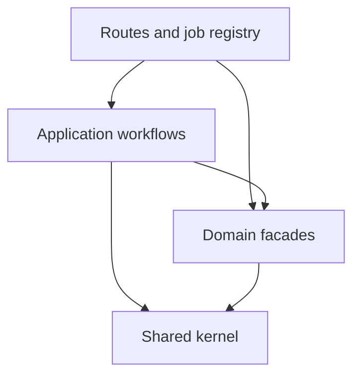

# Service boundaries: ownership and workflow orchestration

## Problem and decision

Credential reads through the user facade also loaded account cleanup and export
orchestration. Those workflows called organizations and playbooks, whose services
called back into user. Tabular implementations also imported their own facade,
which re-exported those implementations. Project lifecycle and export manifest
code were owned by user despite being called by projects.

Keep the modular monolith and explicit TypeScript service functions. Separate
shared capabilities, domain operations and cross-domain application workflows;
classes or separate deployed services are unnecessary for these boundaries.

## Changes

| Former responsibility | Owner and entry point |
| --- | --- |
| User/org encrypted credentials and effective provider selection | `lib/providerCredentials/index.ts`; persistence, settings and contracts are siblings underneath it |
| Personal key settings | `modules/user/user.apiKeys.ts`, a thin adapter to owner-aware credential operations |
| Router model validation shared by orgs and user | `lib/routerModelValidation.ts`; user retains its profile field mapping |
| Project deletion and signed manifest | `modules/projects/projects.lifecycle.ts` and `projects.export.ts`, exported through `projects.service.ts` |
| Scoped reusable memory-export reads | `lib/memory/export.ts` |
| Account deletion, retention and workspace data clearing | `application/accounts/` |
| Permanent organization content purge | `application/organizations/purgeContent.ts`, composing org-owned cleanup operations |
| Export request lifecycle and artifact creation | `application/exports/`; `buildExport.ts` re-authorizes execution |
| Account-delete and export-build queue adapters | `application/jobs/`, imported directly by `jobs/registry.ts` |
| Tabular extraction and maintenance dependencies | Direct sibling implementation imports, without the tabular facade |
| Model catalog and playbook contracts | `models.types.ts`, `playbooks.types.ts` and `playbooks.schemas.ts` below their callers |
| Assistant event contract | Existing `@mike/contracts` definition |
| Web stream sink and live-turn contracts | `assistantTurnTypes.ts`, shared by transport and registry |
| Word reasoning level contract | `modelSelectionTypes.ts`, shared by message and chat declarations |

Routes remain under their domain directories but are entrypoints, not domain
implementations. A route may invoke an application workflow. Domain facades do
not re-export application workflows. Within a domain, topic files import each
other directly instead of importing their own facade.

## Preserved behavior and risks

This is an ownership and dependency refactor, with no schema, route, serialized
contract, job-kind or queue-payload migration. Existing jobs can execute through
the new adapters. The main risk is a missed consumer or altered ordering in a
destructive workflow; existing route and job tests continue to exercise the real
service functions through the new boundaries.

- Credential encryption, user/org/environment precedence, disabled-key behavior
  and endpoint-change key re-entry remain in one implementation. Owner IDs do
  not confer permission: user/org adapters retain authorization and audit policy.
- Project deletion still captures document cleanup before deleting parents and
  completes inline cleanup afterwards. Failed deletes or cleanup remain retryable.
- Account deletion checks sole-owner blockers before destructive work and again
  in queued execution. Organization-owned content and contributed trees retain
  their existing departure semantics. Auth identity deletion remains last.
- Export execution rechecks membership, organization policy and resource access;
  queued permissions are not trusted. Artifact paths remain deterministic by job.
- Storage artifacts are deleted before their last pointers. Failures propagate
  to the existing retry policy; database departure transactions and durable
  document cleanup triggers remain the source of truth.
- `orgs.deletion.ts` still suspends an organization for its 30-day recovery period.
  Permanent content purge is a separate, authorized application workflow.

Account-specific traversal and retention queries remain together in
`application/accounts/dataCleanup.ts`; they coordinate the departure graph.
Reusable project/document/org mutations remain with their domain owners. This
change does not claim that shared database tables have become separate bounded
contexts or that every business dependency is captured by imports.

## Executable acceptance criteria

`architecture.test.ts` uses a syntax parser to enforce the facade, shared-kernel,
HTTP and application-layer rules. `dependencyCycles.test.ts` resolves local
imports and configured aliases, including re-exports, literal dynamic imports,
CommonJS requires and erased type references. It checks production source across
backend, web, Word and desktop, and also checks the backend domain graph excluding
route entrypoints. There is no cycle allowlist. Nonliteral imports and missing
local source dependencies fail explicitly.

Parser and graph regression cases cover erased types, re-exports, dynamic
imports, require calls, aliases, missing sources, indirect cycles and self-imports.
Project lifecycle regression tests cover deduplicated/batched IDs, capture and
completion ordering, and failure propagation. Existing credential, route, export,
queue, organization recovery and PostgreSQL retention suites cover the preserved
behavior above. The PR records the executed builds, coverage gates, database and
browser runs; mock-only suites are distinguished from real-stack tests.

See [backend architecture](backend-architecture.md) for the standing rules.
